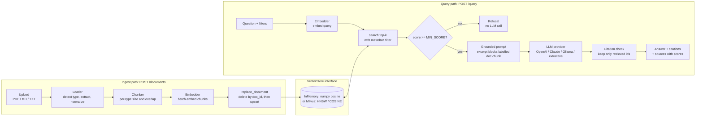

# DocSearch AI: RAG Document Search Assistant

[](https://github.com/Juankia/docsearch-ai-rag/actions/workflows/ci.yml)


[](LICENSE)

DocSearch AI is a retrieval-augmented generation (RAG) service. You upload PDFs, Markdown or text files and ask questions about them. Answers are **grounded in your documents**, carry **`[doc:chunk]` citations**, and come back with similarity scores for every source. When the documents don't contain the answer, the service **refuses** instead of guessing.

It's a small codebase built like a production system. Every moving part sits behind an interface: loaders, chunking, embeddings, the vector store and the LLM. You choose the implementations through configuration. The whole stack runs offline by default, so you can clone it and run `make check` without an API key.

---

## Highlights

| Area | What's implemented |
|---|---|
| **Ingestion** | PDF (`pypdf`), Markdown and plain text. Encoding detection, whitespace normalization, de-hyphenation of PDF text. Stable, URL-safe `doc_id`s. |
| **Chunking** | LangChain `RecursiveCharacterTextSplitter` with **per-document-type** size, overlap and separators. Markdown splits on headings first. |
| **Embeddings** | `Embedder` protocol: offline **hashing** baseline (default, deterministic), **OpenAI**, **Ollama**. Vectors are L2-normalized everywhere. |
| **Vector stores** | `VectorStore` ABC: **InMemory** (numpy exact cosine, default) and **Milvus** (`pymilvus`, HNSW + COSINE, JSON metadata). Both support **metadata filtering** and **delete-by-doc-id**. |
| **Stale vectors** | Re-ingesting a document runs a **delete-then-insert** keyed by `doc_id`, so an old version can't leak into answers. |
| **LLM providers** | **OpenAI**, **Anthropic Claude**, **Ollama**, plus an offline **extractive** answerer. One env var switches between them. |
| **Grounding** | Strict system prompt, `<excerpt id="doc:chunk">` context blocks, citation parsing that **drops hallucinated ids**, and a refusal gate that runs **before** the LLM call. |
| **API** | `POST /documents`, `DELETE /documents/{id}`, `GET /documents`, `POST /query`, `GET /health`. OpenAPI docs at `/docs`. |
| **Evaluation** | `python -m docsearch.evaluation` reports **Hit@k / MRR** and out-of-scope refusal accuracy. `--sweep` compares chunk sizes. |
| **Quality** | 44 pytest tests (fake embedder and fake LLM, no network), ruff, mypy `--strict`, GitHub Actions CI. |

---

## Architecture



```
src/docsearch/
├── api/            # FastAPI app factory, request/response schemas (HTTP concerns only)
├── ingestion/      # loaders.py (PDF/MD/TXT -> text), chunking.py (per-type splitters)
├── embeddings/     # Embedder protocol, hashing (offline), OpenAI, Ollama
├── vectorstores/   # VectorStore ABC, InMemory (numpy), Milvus (pymilvus)
├── llm/            # LLMClient protocol, OpenAI / Anthropic / Ollama adapters
├── rag/            # prompting (grounding + citations), generation, RAGService
├── container.py    # composition root: settings -> concrete implementations
├── config.py       # pydantic-settings, per-doc-type chunking defaults
├── evaluation.py   # Hit@k / MRR retrieval evaluation
└── main.py         # ASGI entrypoint
```

Dependencies only point inward. `RAGService` knows the `Embedder`, `VectorStore` and `AnswerGenerator` interfaces and nothing about FastAPI, Milvus or any SDK. Provider SDKs are imported lazily, so an unused provider costs nothing at import time.

---

## Quickstart

### Local (no API keys needed)

```bash
git clone https://github.com/Juankia/docsearch-ai-rag.git
cd docsearch-ai-rag
make install          # creates .venv and installs the package with dev extras
make check            # ruff + mypy + pytest
make run              # http://localhost:8000/docs
```

In another terminal:

```bash
./scripts/ingest_samples.sh                 # uploads the fictional docs in ./samples
```

The defaults (`EMBEDDING_PROVIDER=hashing`, `LLM_PROVIDER=extractive`, `VECTOR_STORE=memory`) work fully offline. To use real models, copy `.env.example` to `.env` and set:

```bash
# Claude
LLM_PROVIDER=anthropic
ANTHROPIC_API_KEY=...
# LLM_MODEL defaults to claude-opus-5-5

# or OpenAI for both embeddings and generation
EMBEDDING_PROVIDER=openai
EMBEDDING_DIM=1536
LLM_PROVIDER=openai
OPENAI_API_KEY=...

# or fully local with Ollama
EMBEDDING_PROVIDER=ollama
EMBEDDING_MODEL=nomic-embed-text
EMBEDDING_DIM=768
LLM_PROVIDER=ollama
LLM_MODEL=llama3.1
```

Install the provider extras you need: `pip install -e ".[anthropic]"`, `".[openai]"`, `".[milvus]"` or `".[all]"`.

### Docker

```bash
docker compose up --build                                        # API + in-memory store
VECTOR_STORE=milvus docker compose --profile milvus up --build   # API + Milvus standalone (etcd, MinIO)
```

The `milvus` profile starts Milvus 2.4 standalone with its etcd and MinIO dependencies. Data is persisted under `./volumes/`, which is git-ignored.

---

## API examples

**Upload a document** (`metadata` is optional; it must be a flat JSON object):

```bash
curl -s -F "file=@samples/employee-handbook.md" \
     -F 'metadata={"department":"hr"}' \
     http://localhost:8000/documents
```

```json
{"doc_id":"employee-handbook","source":"employee-handbook.md","doc_type":"markdown","chunks":8,"replaced_chunks":0}
```

Upload the same file again and you get `"replaced_chunks": 8`. The old vectors were deleted before the new ones were written.

**Ask a question:**

```bash
curl -s http://localhost:8000/query \
     -H 'content-type: application/json' \
     -d '{"question": "How many vacation days can I carry over?", "top_k": 3}'
```

```json
{
  "answer": "Up to 5 unused vacation days can be carried over to the next year; carried-over days expire on March 31. [employee-handbook:2] ...",
  "grounded": true,
  "citations": ["employee-handbook:2"],
  "sources": [
    {"id": "employee-handbook:2", "doc_id": "employee-handbook", "chunk_index": 2,
     "source": "employee-handbook.md", "score": 0.2176, "cited": true, "text": "## 2. Paid Time Off ..."},
    {"id": "employee-handbook:7", "score": 0.1877, "cited": false, "...": "..."}
  ],
  "generator": "extractive",
  "latency_ms": 1.2
}
```

(Real output with the offline defaults. Scores from the hashing embedder are lower than semantic-model scores, which is why `MIN_SCORE` is configurable.)

**Restrict the search with metadata filters** (equality; a list means "any of"):

```bash
curl -s http://localhost:8000/query -H 'content-type: application/json' \
     -d '{"question": "How fast must incidents be reported?", "filters": {"doc_type": ["text", "pdf"]}}'
```

**Out-of-scope question.** The service refuses without calling the LLM:

```bash
curl -s http://localhost:8000/query -H 'content-type: application/json' \
     -d '{"question": "What is the capital of Australia?"}'
# {"answer": "I don't have enough information in the indexed documents to answer that.", "grounded": false, ...}
```

**Delete, list and health:**

```bash
curl -s -X DELETE http://localhost:8000/documents/employee-handbook   # {"doc_id":"employee-handbook","deleted_chunks":8}
curl -s http://localhost:8000/documents
curl -s http://localhost:8000/health
```

| Status | When |
|---|---|
| `201` | Document indexed |
| `404` | `DELETE` of an unknown `doc_id` |
| `413` | Upload larger than `MAX_UPLOAD_BYTES` (10 MB) |
| `415` | Unsupported file type |
| `422` | Empty document, invalid metadata or `doc_id`, invalid query |
| `502` | Upstream provider (LLM, embeddings, Milvus) failed |

---

## Retrieval evaluation

`eval/qa.jsonl` holds 33 answerable questions over the three sample documents, plus 4 out-of-scope questions. Each answerable item names the expected `doc_id` and an **evidence span**. A retrieved chunk counts as relevant only if it comes from that document **and** contains the span. Labels therefore stay valid when chunking changes, which is what lets the script compare chunk sizes fairly.

```bash
python -m docsearch.evaluation            # current configuration
python -m docsearch.evaluation --sweep    # chunk-size ablation
python -m docsearch.evaluation --json     # machine-readable
```

**Results** (offline hashing embedder + in-memory store, default per-type chunking):

| Config | Chunks | Hit@1 | Hit@3 | Hit@5 | MRR@5 | OOS refused |
|---|---|---|---|---|---|---|
| hashing + memory (per-type chunking) | 19 | 0.879 | 0.909 | 0.970 | 0.908 | 4/4 |

**Chunk-size sweep** (same chunk size applied to every document type):

| Config | Chunks | Hit@1 | Hit@3 | Hit@5 | MRR@5 | OOS refused |
|---|---|---|---|---|---|---|
| size=300/overlap=50 | 46 | 0.818 | 0.909 | 0.970 | 0.872 | 4/4 |
| size=500/overlap=80 | 28 | 0.818 | 0.939 | 1.000 | 0.892 | 4/4 |
| size=700/overlap=80 | 20 | 0.879 | 0.909 | 0.970 | 0.908 | 4/4 |
| size=1000/overlap=150 | 13 | 0.879 | 0.970 | 1.000 | 0.932 | 4/4 |
| size=1500/overlap=200 | 9 | 0.727 | 0.909 | 0.970 | 0.828 | 4/4 |

How to read these numbers:

- The **hashing embedder is a lexical baseline**, not a semantic model. It's included so the numbers are reproducible in CI without network access. A real embedding model should close most of the remaining gap on paraphrased questions.
- On a corpus this small, larger chunks look good because a whole FAQ section fits in one chunk. At 1500 characters, Hit@1 drops sharply: chunks mix topics and the signal gets diluted. Larger chunks also mean more prompt tokens per answer, so the defaults (700 to 1000 characters) are a deliberate middle ground.
- CI runs the evaluation on every push, and `tests/test_rag_service.py::test_eval_on_samples_meets_baseline` fails the build if Hit@5 drops below 0.9 or MRR below 0.8.

---

## Design decisions

### Why Milvus (vs. MongoDB Atlas Vector Search)

Both are solid choices. The right one depends on where the rest of your data lives.

| | **Milvus** (self-hosted or Zilliz Cloud) | **MongoDB Atlas Vector Search** |
|---|---|---|
| **Latency** | Purpose-built engine (HNSW, IVF, DiskANN, GPU indexes). Index parameters such as `M`, `efConstruction` and `ef` can be tuned per collection, so p99 stays low at tens of millions of vectors. | Good for moderate scale. It runs on dedicated Search Nodes next to the operational DB, and you have fewer index knobs to tune. |
| **Recall** | You trade recall against latency explicitly (`ef` at query time, index type per workload). Scalar indexes plus JSON filtering happen inside the ANN search. | HNSW with `numCandidates` for the recall/latency trade-off. Pre-filtering on indexed fields. Less control over index internals. |
| **Cost** | Open source. Self-hosting costs compute and ops time (etcd, MinIO/S3, upgrades). Cost per vector is low at scale. Zilliz Cloud is available if you don't want to run it. | No extra system if you already use Atlas, and vectors live next to the source documents (no sync pipeline). Search Nodes are billed on top of the cluster and get expensive at high vector counts. |
| **Pick it when** | Vectors are a first-class workload: large corpora, strict latency SLOs, a need to tune recall, or a requirement to stay cloud-agnostic. | The data is already in MongoDB, the corpus is small to medium, and operational simplicity matters more than squeezing out latency. |

This project uses Milvus as its production backend because the goal is a dedicated, tunable retrieval tier. The `VectorStore` interface is small (`upsert`, `delete_by_doc_id`, `search`, `count`, `list_documents`), so an Atlas, pgvector or Qdrant adapter would be roughly a 150-line file and wouldn't touch any other layer.

Milvus specifics in `vectorstores/milvus.py`:

- **HNSW + COSINE** (`M=16`, `efConstruction=200`). At query time, `ef = max(64, 4k)`.
- `doc_id`, `doc_type`, `source` and `chunk_index` are real scalar columns, with an `INVERTED` index on `doc_id` for fast deletes and filters. Arbitrary user metadata goes into a `JSON` column and is filtered with `metadata["key"] == value`.
- Filter expressions are built from validated keys and JSON-escaped literals, which guards against injection into the boolean expression.
- The collection uses **`Strong` consistency**, so a query that runs right after a re-ingest can't see vectors that were just deleted.

### Chunking

- **Per-type defaults** (in `config.py`): Markdown 700/80, text 800/120, PDF 1000/150 characters. PDF text is noisy (page breaks, hyphenation, headers), so it gets more room and more overlap.
- **Separators per type.** Markdown tries `## `, `### ` and so on first, so a chunk rarely spans two sections. A test checks this. Prose falls back to paragraphs, then sentences, then words.
- **Overlap** keeps a fact that sits on a boundary retrievable from both sides.
- Chunk ids are `doc_id:chunk_index`. The same string is the citation label, so you can trace a citation in an answer directly back to a stored row.

### Stale-vector handling

The usual RAG bug: version 1 of a document produced 10 chunks, version 2 produces 7, and a plain upsert leaves chunks 7 to 9 of version 1 in the index. Those orphans keep matching queries and serve outdated policy text.

How this project prevents it:

1. **Deterministic `doc_id`s.** They come from the filename (`Employee Handbook.md` becomes `employee-handbook`) or are passed explicitly. Re-uploading always targets the same document.
2. **`VectorStore.replace_document`** deletes every chunk with that `doc_id`, then upserts the new chunks. The API returns `replaced_chunks`, so clients can see what was replaced.
3. **Strong consistency** on Milvus makes the delete visible to the next search.
4. Tests cover both the store (`test_replace_document_removes_stale_chunks`) and the service end to end (`test_reingest_replaces_instead_of_duplicating`: after re-upload, only the new "25 days" text is retrievable).

For high-traffic systems, the next step is versioned writes: write version N+1 under a new `version` field, then delete version N. That removes the short window in which the document has no chunks at all.

### Grounding and refusals

- **Two refusal layers.** (1) If no chunk scores at least `MIN_SCORE`, the service refuses **without calling the LLM**, which is cheaper, faster and carries zero hallucination risk. (2) Otherwise the system prompt tells the model to reply with an exact refusal sentence when the context is insufficient, and the service detects that sentence.
- Context is wrapped in `<excerpt id=...>` tags, and the prompt says to treat it as data. This is a basic defense against prompt injection hidden in uploaded documents.
- **Citation validation.** Only ids that were actually retrieved are kept. A made-up `[other-doc:99]` is dropped, and `grounded` is `true` only when at least one valid citation remains.
- The Claude adapter uses the official `anthropic` SDK with low effort (short grounded answers don't need deep reasoning) and treats a `refusal` stop reason as an empty answer, which the service maps to the standard refusal.

---

## Testing

```bash
make check       # ruff lint + format check, mypy --strict, pytest
```

- `tests/fakes.py` provides a **deterministic bag-of-words `FakeEmbedder`**, a **`FakeLLM`** that records prompts and returns scripted, cited answers, and a tiny in-memory **PDF builder**. No test touches the network or needs a key.
- The Milvus adapter is tested against a **fake `MilvusClient`**. The tests check the exact filter expressions and delete calls sent to Milvus and the round-trip of metadata.
- API tests use FastAPI's `TestClient` with an app factory that **injects** the fake-wired `RAGService`.

---

## Configuration reference

| Variable | Default | Notes |
|---|---|---|
| `EMBEDDING_PROVIDER` | `hashing` | `hashing` \| `openai` \| `ollama` |
| `EMBEDDING_MODEL` / `EMBEDDING_DIM` | `text-embedding-3-small` / `512` | The dimension must match the model (and the Milvus collection) |
| `LLM_PROVIDER` | `extractive` | `extractive` \| `openai` \| `anthropic` \| `ollama` |
| `LLM_MODEL` | provider default | `claude-opus-5-5`, `gpt-4o-mini`, `llama3.1` |
| `VECTOR_STORE` | `memory` | `memory` \| `milvus` |
| `MILVUS_URI` / `MILVUS_COLLECTION` | `http://localhost:19530` / `docsearch_chunks` | |
| `TOP_K` / `MIN_SCORE` | `4` / `0.15` | Calibrate `MIN_SCORE` per embedding model using the eval script |

---

## Roadmap

- [ ] **Reranking:** cross-encoder (e.g. `bge-reranker`) or an LLM reranker over the top 20 to 50 candidates, then keep the top k.
- [ ] **Hybrid search:** BM25 / sparse vectors combined with dense vectors via Reciprocal Rank Fusion (Milvus 2.4 supports multi-vector hybrid search natively).
- [ ] Streaming answers (SSE) and token and cost accounting per request.
- [ ] Versioned re-ingestion (write version N+1, then delete version N) for zero-gap updates.
- [ ] Async ingestion queue for large PDFs, plus OCR for scanned documents.
- [ ] Answer-level evaluation (faithfulness and answer relevance) on top of the current retrieval metrics.
- [ ] AuthN/Z with per-tenant metadata filters enforced server-side.
- [ ] Additional `VectorStore` adapters: pgvector, Atlas Vector Search, Qdrant.

---

## About the author

**Juan Carlos Amay**, AI Architect and Senior Full Stack Engineer based in Ecuador. He has 8+ years building fintech and banking systems and now designs RAG pipelines, LLM agents and MCP integrations.

- GitHub: [@Juankia](https://github.com/Juankia)
- LinkedIn: [juancarlosamayizquierdo](https://linkedin.com/in/juancarlosamayizquierdo)

All sample documents in `samples/` are fictional and were written for this demo.

## License

[MIT](LICENSE) © 2026 Juan Carlos Amay
